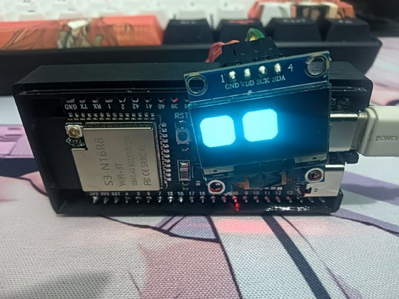
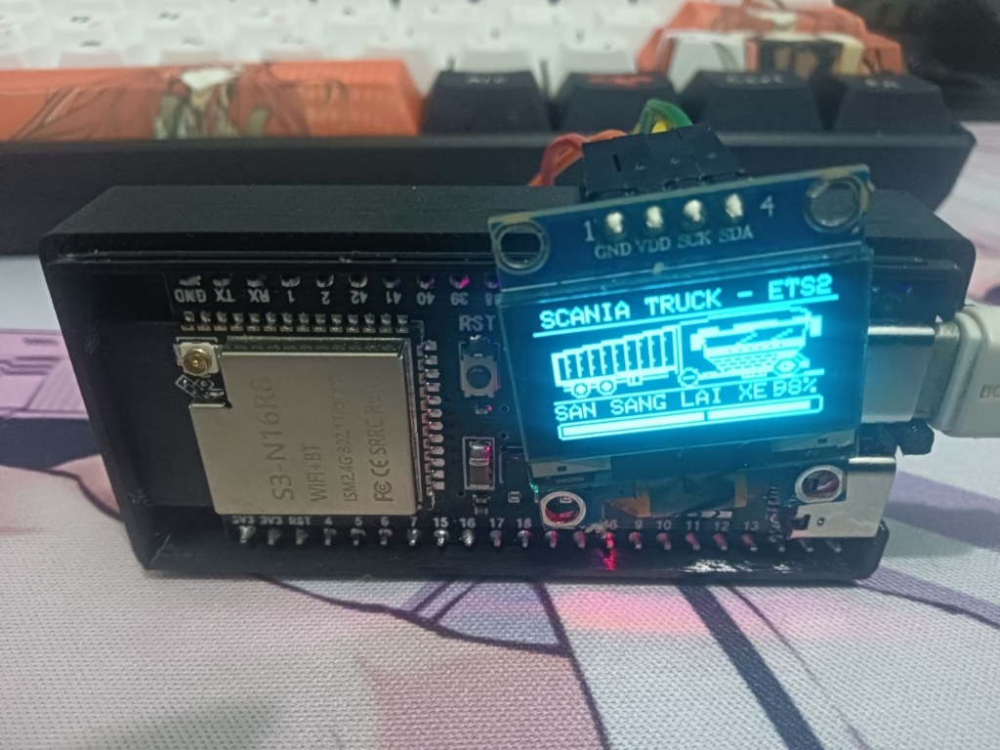
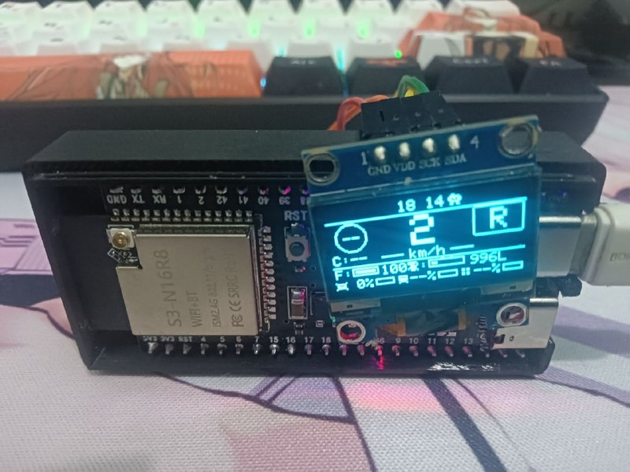

# ESP32-ETS2-HUD — SIM RACING & DIGITAL COCKPIT DISPLAY

> **Hệ thống Màn Hình Buồng Lái Kỹ Thuật Số (Sim Racing Cockpit HUD)** chuyên dụng render và hiển thị dữ liệu telemetry thời gian thực cho **Euro Truck Simulator 2 (ETS2 & TruckersMP)** và **American Truck Simulator (ATS)** trên vi điều khiển **ESP32-S3 (N16R8)** với màn hình OLED 128x64.

---

## 🏷️ Danh Mục Game & Hệ Thống (Game Tags & Topics)

### Game & Thể Loại Mô Phỏng
`#EuroTruckSimulator2` `#AmericanTruckSimulator` `#ETS2` `#ATS` `#SCSSoftware` `#SimRacing` `#TruckSimulator` `#SCSModding` `#SimulationGames`

### Công Nghệ & Phần Cứng
`#ESP32S3` `#SSD1306` `#SH1106` `#OLED128x64` `#FreeRTOS` `#DualCore` `#DigitalCockpit` `#TelemetryDashboard` `#SimRigHardware` `#ModelContextProtocol` `#PlatformIO`

---

## 📸 3 Chế Độ Hoạt Động Thông Minh Trong Thực Tế (Smart Real-World Modes)

Dưới đây là hình ảnh chụp hoạt động thực tế 100% trên phần cứng **ESP32-S3 (N16R8) + Màn hình OLED 0.96" + Vỏ bảo vệ M39**, hệ thống tự động nhận diện và chuyển đổi thông minh qua 3 chế độ:

| **Chế Độ 1: Mắt Robot Để Bàn (Desktop Pet)** | **Chế Độ 2: Màn Hình Tải Map (ETS2 Loading)** | **Chế Độ 3: Đồng Hồ Xe Buồng Lái (Cockpit)** |
|:---:|:---:|:---:|
|  |  |  |
| **Khi Rảnh (Không Chạy Game)**<br>Biến thành thú cưng để bàn, tự chớp mắt và đổi biểu cảm vui/tò mò | **Khi Vào Game Đang Tải (Loading)**<br>Xe Scania Container + thanh tiến trình 0–100% (*SAN SANG LAI XE 98%*) | **Khi Vào Buồng Lái Lái Xe**<br>Vận tốc to nét (`2 km/h`), Hộp số (`R`), Giờ (`18:14`), Xăng (`100% 996L`) |

---

### Chi Tiết Hoạt Động Từng Chế Độ

1. **Chế Độ 1 — Thú Cưng Để Bàn Mắt Robot (RoboEyes Desktop Pet)**:
   - **Thời điểm kích hoạt**: Khi bạn đang làm việc bình thường trên Windows và **chưa bật game**.
   - **Hành vi**: Màn hình tự động hóa thành đôi mắt robot chuyển động sống động (tự chớp mắt ngẫu nhiên, liếc trái/phải, đổi biểu cảm vui, buồn, mệt mỏi, tò mò). Biến thiết bị thành thú cưng công nghệ (Desktop Companion) sinh động trên bàn làm việc.
2. **Chế Độ 2 — Màn Hình Khởi Động & Tải Map Game (ETS2 Loading Splash)**:
   - **Thời điểm kích hoạt**: Khi bạn bật game Euro Truck Simulator 2, đang xem video giới thiệu của nhà phát hành SCS Software hoặc khi game đang tải màn chơi (Loading Map).
   - **Hành vi**: Màn hình tự động chuyển sang logo `SCANIA TRUCK - ETS2`, hình ảnh xe đầu kéo Scania kéo thùng container bạc dập gân, thông báo trạng thái `SAN SANG LAI XE 98%` và thanh tiến trình bo góc mượt mà từ 0% đến 100%.
3. **Chế Độ 3 — Taplo Buồng Lái Kỹ Thuật Số (Digital Cockpit Dashboard)**:
   - **Thời điểm kích hoạt**: Ngay khi bạn bước vào buồng lái lái xe.
   - **Hành vi**: Màn hình hiển thị đầy đủ thông số thời gian thực: Giờ cabin (18:14), Vận tốc số to nét (`2 km/h`), Khung hộp số bo góc (`R`, `D1`..`D12`, `C1`, `C2`), Thước Xăng % và lít dầu thực tế (`100% (996L)`), Cụm đo độ bền xe tải / rơ-moóc / hàng hóa (`0% --% --%`), và hệ thống cảnh báo buồng lái (xi-nhan, đèn pha, gạt mưa, còi).

---

## 📸 Thiết Kế Giao Diện Buồng Lái Chi Tiết (Digital Cockpit Layout)

Màn hình OLED 128x64 được thiết kế theo tỷ lệ phân chia 3 cột công thái học (Ergonomic 3-Column Layout), tối ưu hóa góc nhìn của tài xế khi gắn trên Vô-lăng hoặc Sim Rig:

```
┌─────────────────────────────────────────────────────────────┐
│  <  D  WIP [2]     14:25           R2  CC [85]  >  │  Hàng 1: Xi-nhan | Đèn | Gạt mưa | Giờ | Retarder | CC
├─────────────────────────────────────────────────────────────┤
│   [80]                 85                [ D12 ]   │  Hàng 2: Biển báo tốc độ (Chớp) | Tốc độ số to nét
│   C:70             ── km/h ──             [ P ]    │  Hàng 3: Cảnh báo camera | Vạch phân cách | Phanh tay
├─────────────────────────────────────────────────────────────┤
│  F: [■■■■■■■■□□] 78%       R: [■■■■■|■■|  ] 1350   │  Hàng 4: Thước Xăng % & Thước RPM dải kinh tế xanh
│  T: 2%        C: 0%        778L           140km    │  Hàng 5: Độ bền xe | Hàng hóa | Lít thực | Cự ly ETA
└─────────────────────────────────────────────────────────────┘
```

### Các Khối Hiển Thị Trực Quan
- **Khu vực Trung tâm (Tốc độ km/h)**: Phông số kích thước lớn (Font 3: 21x16 pixel), đường nét tương phản cao, căn giữa tuyệt đối, giúp nhận diện vận tốc tức thì.
- **Khu vực Cột phải (Hộp số buồng lái & Trạng thái phanh)**:
  - Khung hộp số bo góc (Rounded Box) hiển thị chính xác cấp số hiển thị taplo: Số tiến (`D1` .. `D12`), Số bò địa hình (`C1`, `C2` cho hộp số Scania/Volvo 14 cấp), Số Mo (`N`), Số lùi đa cấp (`R1`, `R2`).
  - Biểu tượng phanh cơ khí / phanh đỗ xe `[ P ]`.
- **Khu vực Cột trái (Biển báo & Giới hạn tốc độ Châu Âu)**:
  - Khung biển báo tròn `[80]`, `[90]`: Tự động nhận diện tốc độ quy định của cung đường hiện tại. Tự động chớp nháy tương phản ngược (chữ trắng nền đen) khi xe chạy vượt quá tốc độ quy định.
  - Vận tốc đã cài đặt cho hệ thống ga tự động (`C:70`).
- **Khu vực Thước đo Kép (Dual Bar Gauges)**:
  - **Thước Nhiên Liệu (Fuel Gauge)**: Thanh đo 10 nấc kèm tỷ lệ phần trăm và số lít dầu thực tế (`778L`). Tự động chớp nháy cảnh báo khi nhiên liệu xuống dưới 15%.
  - **Thước Vòng Tua Máy (RPM Bar)**: Mô phỏng vòng tua máy thời gian thực với vạch căn dải tua kinh tế (Green Economy Band: 1000 - 1500 RPM) của các dòng động cơ xe tải nặng.
- **Khu vực Thống kê Độ Bền & Hành Trình (Trip Advisor)**:
  - `T:%` (Truck Wear): Tỷ lệ hao mòn tổng thể đầu kéo xe (Động cơ, hộp số, cabin, khung gầm, lốp xe).
  - `C:%` (Cargo Wear): Tỷ lệ tổn hại hàng hóa và rơ-moóc.
  - `ETA`: Cự ly còn lại đến điểm giao hàng (km).

---

## 🔔 Hệ Thống Đèn Báo & Thông Báo Buồng Lái (Cockpit Indicators & Alerts)

| Ký Hiệu / Nhãn | Chức Năng | Hành Vi & Trạng Thái |
|---|---|---|
| `<` / `>` | Đèn xi-nhan Trái / Phải | Chớp nháy đồng bộ 1Hz theo rơ-le xi-nhan trong game |
| `D` | Đèn chiếu sáng | Đèn sương mù, đèn pha cốt, đèn chiếu xa |
| `WIP [1..4]` | Cần gạt nước mưa | Hiển thị trạng thái bật và cấp độ gạt mưa (Cấp 1 đến 4) |
| `HORN` | Còi xe buồng lái | Hiển thị biểu tượng khi tài xế bấm còi/kèn hơi |
| `R [1..5]` | Phanh hãm phụ (Retarder) | Hiển thị cấp độ phanh thủy lực Retarder từ nấc 1 đến nấc 5 |
| `CC [km/h]` | Hệ thống ga tự động (Cruise Control) | Hiển thị khi kích hoạt kèm vận tốc ga tự động đã lưu |
| `[ P ]` | Phanh dừng đỗ (Parking Brake) | Bật sáng khi phanh tay được kéo |
| `AIR` | Phanh khí nén khẩn cấp | Cảnh báo khi áp suất bình hơi giảm thấp nguy hiểm |
| `ENG` | Đèn kiểm tra động cơ | Bật sáng khi động cơ bị hỏng hóc hoặc chết máy |
| `TOLL: -45 EUR` | Thông báo qua trạm thu phí | Hiển thị Popup Toast tự động biến mất sau 3 giây |
| `FINE: -550 EUR`| Cảnh báo vi phạm giao thông / bắn tốc độ | Hiển thị Popup Toast tự động biến mất sau 3 giây |
| `CRASH: -400 EUR`| Cảnh báo va chạm / tai nạn | Hiển thị Popup Toast tự động biến mất sau 3 giây |

---

## 📦 Kê Khai Thư Viện Bên Thứ Ba (Third-Party Libraries & Dependencies)

Dự án cam kết minh bạch về việc sử dụng các thành phần mã nguồn mở và bộ công cụ của bên thứ ba:

### 1. Phân Hệ Nhúng Vi Điều Khiển (ESP32-S3 Firmware)

| Tên Thư Viện | Phiên Bản | Tác Giả / Tổ Chức | Giấy Phép | Vai Trò & Mục Đích Trong Hệ Thống |
|---|---|---|---|---|
| **Adafruit SSD1306** | `^2.5.7` | Adafruit Industries | BSD 3-Clause | Trình điều khiển giao tiếp phần cứng I2C cho màn hình OLED 128x64 (SSD1306 / SH1106). |
| **Adafruit GFX Library**| `^1.11.9` | Adafruit Industries | BSD 2-Clause | Thư viện lõi đồ họa: vẽ điểm, đường thẳng, khung chữ nhật bo góc, icon bitmap nhị phân. |
| **ArduinoJson** | `^6.21.4` | Benoit Blanchon | MIT | Bộ giải mã (parser) và đóng gói chuỗi JSON tốc độ cao từ kênh Serial USB CDC. |
| **FluxGarage RoboEyes** | `v1.0.0 (Customized)` | Dennis Bueschel (FluxGarage) | MIT | Hệ thống diễn hoạt mắt biểu cảm robot đa trạng thái (Vui, Buồn, Mệt, Tức giận, Ngủ, Liếc nhìn). |
| **Espressif Arduino Core** | `~6.5.0 (IDF v4.4+)` | Espressif Systems | Apache 2.0 | Bộ công cụ phát triển phần cứng ESP32-S3, trình điều khiển USB CDC OTG, I2C và NVS. |
| **FreeRTOS Kernel** | `SMP v10.x` | Amazon Web Services / FreeRTOS | MIT | Hệ điều hành đa nhiệm thời gian thực, điều phối 2 nhân vi xử lý (Core 0 nhận dữ liệu, Core 1 xuất đồ họa). |

### 2. Phân Hệ Máy Tính Cầu Nối (PC Companion & Automation)

| Tên Thư Viện | Phiên Bản | Tác Giả / Nguồn | Giấy Phép | Vai Trò & Mục Đích Trong Hệ Thống |
|---|---|---|---|---|
| **pyserial** | `>=3.5` | Chris Liechti | BSD 3-Clause | Kênh giao tiếp truyền thông nối tiếp tốc độ cao (Baud Rate 460800) giữa Windows PC và ESP32-S3. |
| **psutil** | `>=5.9.0` | Jay Loden, Giampaolo Rodola | BSD 3-Clause | Giám sát trạng thái tiến trình game (`eurotrucks2.exe` / `amtrucks.exe`) để tự động chuyển cảnh. |
| **requests** | `>=2.28.0` | Kenneth Reitz & PSF | Apache 2.0 | Giao thức HTTP REST Client dự phòng để kết nối tới cổng Telemetry Server WebApi (Port 25555). |

### 3. Phân Hệ Trích Xuất Dữ Liệu Game (Game Telemetry Engines & Plugins)

| Thành Phần | Phiên Bản | Tác Giả / Nhà Cung Cấp | Giấy Phép | Vai Trò & Mục Đích Trong Hệ Thống |
|---|---|---|---|---|
| **RenCloud SCS SDK Plugin** | `v1.1.0+` | RenCloud / nlhans | MIT | Plugin C++ (`scs-telemetry.dll`) gắn trực tiếp vào game engine SCS, tạo bộ nhớ chia sẻ `Local\SCSTelemetry`. |
| **Funbit ETS2 Telemetry Server**| `v4.0.0` | Funbit / Denilson Sá Maier | MIT | Máy chủ Telemetry (`Ets2Telemetry.exe`) cung cấp bộ nhớ chia sẻ `Local\Ets2TelemetryServer` và REST API. |
| **Microsoft OWIN / Katana** | `v3.0.0` | Microsoft Corporation | Apache 2.0 | Nền tảng máy chủ HTTP tự lưu trữ (Self-Hosted HTTP Web Server) cho Telemetry Server. |
| **Microsoft SignalR Core** | `v2.x` | Microsoft Corporation | Apache 2.0 | Kênh truyền thông thời gian thực hai chiều dựa trên công nghệ WebSocket / Long Polling. |
| **Newtonsoft.Json** | `v12.0+` | James Newton-King | MIT | Bộ tuần tự hóa và giải mã dữ liệu JSON cho nền tảng .NET Framework. |
| **log4net** | `v2.x` | Apache Software Foundation | Apache 2.0 | Phân hệ ghi vết và quản lý tệp nhật ký hệ thống của Telemetry Server. |

---

## ⚡ Kiến Trúc Luồng Dữ Liệu & Hiệu Năng (Architecture & Data Flow)

Hệ thống hoạt động theo nguyên lý kênh truyền phân tầng khép kín, triệt tiêu độ trễ hiển thị:

```
┌─────────────────────────────────┐
│ Euro Truck Simulator 2 / ATS   │
│ (SCS Software Game Engine)     │
└──────────────┬──────────────────┘
               │  Bộ nhớ dùng chung Windows (Shared Memory)
               ▼  Độ trễ < 0.5ms (Không qua lớp mạng IP)
┌─────────────────────────────────┐
│ Windows Shared Memory Block     │
│ ("Local\SCSTelemetry")          │
└──────────────┬──────────────────┘
               │  Tần số đọc: 30 Lần/giây
               ▼  Thuật toán bù trừ hộp số Crawler (C1, C2)
┌─────────────────────────────────┐
│ PC Companion Daemon             │
│ (tools/miu_desktop_ets2.py)     │
└──────────────┬──────────────────┘
               │  USB CDC Serial tốc độ cực cao: 460,800 Baud
               ▼  Gói tin JSON rút gọn tối ưu hóa băng thông
┌─────────────────────────────────┐
│ ESP32-S3 Core 0 (Task USB)      │ ──► Giải mã JSON, cập nhật Struct dữ liệu
└──────────────┬──────────────────┘
               │  Bộ đệm chia sẻ an toàn luồng FreeRTOS
               ▼
┌─────────────────────────────────┐
│ ESP32-S3 Core 1 (Task Display)  │ ──► Màn hình OLED I2C (29.3 - 30.0 FPS mượt mà)
└─────────────────────────────────┘
```

### Chỉ Số Tối Ưu Hóa Hệ Thống
- **Tốc độ Baud Rate**: **460,800 baud** (Nhanh gấp 4 lần chuẩn 115200 truyền thống, triệt tiêu hoàn toàn hiện tượng trễ nhịp nhảy số).
- **Tốc độ khung hình (Frame Rate)**: **29.3 – 30.0 FPS** ổn định liên tục.
- **Thời gian xử lý vòng lặp (Cycle Latency)**: **< 5 mili-giây**.
- **Mức tiêu hao CPU Máy tính**: **< 0.1%** nhờ cơ chế truy xuất trực tiếp con trỏ bộ nhớ dùng chung.
- **Tài nguyên vi điều khiển ESP32-S3**:
  - Dung lượng Flash: **~394 KB / 4.6 MB** (Chiếm ~8.4% phân vùng ứng dụng).
  - Dung lượng RAM: **~25.2 KB / 327 KB** (Chiếm ~7.7% SRAM nội, không rò rỉ bộ nhớ).

---

## 🔌 Kê Khai Phần Cứng & Sơ Đồ Đấu Nối Dây (Hardware Specs & Wiring Diagram)

### 1. 🛒 Danh Mục Linh Kiện & Link Mua Sắm Đã Kiểm Chứng (Hardware Bill of Materials - BOM)

Toàn bộ các linh kiện phần cứng được sử dụng và kiểm chứng thực tế trong dự án đều có thể tìm mua dễ dàng trên Shopee với chi phí rất tiết kiệm:

| STT | Tên Linh Kiện | Quy Cách & Thông Số Kỹ Thuật | Vai Trò & Ứng Dụng | Link Mua Tham Khảo (Shopee) |
|:---:|---|---|---|:---:|
| 1 | **Bo Mạch ESP32-S3-WROOM-1** | • Phiên bản 44 chân (44Pin)<br>• Cổng kép Type-C USB OTG + UART<br>• 16MB Flash (N16) + 8MB PSRAM (R8)<br>• Wi-Fi 2.4G & Bluetooth 5.0 | Bộ xử lý trung tâm điều phối 2 nhân 240MHz: Nhân 0 nhận dữ liệu 460800 baud, Nhân 1 render đồ họa mượt mà 30 FPS. | [Xem trên Shopee](https://shopee.vn/B%E1%BA%A3ng-ph%C3%A1t-tri%E1%BB%83n-ESP32-S3-M%C3%B4-%C4%91un-Wifi-2.4G-cho-Arduino-ESP-IDF-ESP32-S3-WROOM-1-N16R8-44Pin-Type-C-16MB-Flash-8M-PSRAM-ESP32-S3-i.578443443.48061933309) |
| 2 | **Màn Hình OLED 0.96 inch I2C** | • Kích thước: 0.96 inch (128x64 pixels)<br>• Chuẩn giao tiếp: 4 Chân I2C (GND, VDD, SCK, SDA)<br>• Phân loại: Xanh dương hoặc Vàng-Xanh | Màn hình hiển thị Taplo kỹ thuật số nhỏ gọn, độ tương phản cao, góc nhìn rộng, tốc độ làm tươi nhanh và tiết kiệm chi phí nhất. | [Xem trên Shopee](https://shopee.vn/M%C3%B4-%C4%90un-Hi%E1%BB%83N-Th%E1%BB%8B-OLED-4pin-7pin-0.96-IIC-I2C-OLED-0.96-inch-128X64-OLED-0.96-IIC-I2C-Chuy%C3%AAn-D%E1%BB%A5ng-Cho-arduino-i.578443443.23972641115?extraParams=%7B%22display_model_id%22%3A39674326890%2C%22model_selection_logic%22%3A3%7D) |
| 3 | **Vỏ Màn Hình OLED 0.96" / 1.3"** | • Vỏ bảo vệ in 3D chuyên dụng (Ver-2)<br>• Tương thích màn hình OLED 0.96 inch & 1.3 inch<br>• Đóng gói: Set 2 cái | Cố định và bảo vệ màn hình hiển thị chắc chắn, thẩm mỹ cao khi gắn lên vô lăng lái xe, taplo bàn làm việc hoặc khung Sim Rig. | [Xem trên Shopee](https://shopee.vn/(set-2-c%C3%A1i)-V%E1%BB%8F-m%C3%A0n-h%C3%ACnh-oled-0-96-inch-v%C3%A0-1.3-inch-Ver-2-i.310609561.50102722042) |
| 4 | **Module LCD2004 Kèm I2C** | • Kích thước: 20 ký tự x 4 dòng (2004)<br>• Kèm module chuyển đổi I2C hàn sẵn<br>• Màn to hơn cho góc nhìn xa | Tùy chọn màn hình phụ cỡ lớn cho góc nhìn xa hơn trên buồng lái mô phỏng (Sim Rig). | [Xem trên Shopee](https://shopee.vn/Module-m%C3%A0n-h%C3%ACnh-LCD2004-k%C3%A8m-module-I2C-(H%C3%A0n-s%E1%BA%B5n)-i.16504852.21983158179?xptdk=34adf420-732b-4182-9063-b6082759be93) |
| 5 | **Dây Cắm Test Board Dupont** | • Dây cắm 4 sợi Dupont (10 - 20cm)<br>• Khuyên dùng: Loại Cái - Cái (Female - Female)<br>• Lõi đồng truyền tín hiệu ổn định | Kết nối 4 chân I2C từ màn hình hiển thị trực tiếp sang các chân header của bo mạch ESP32-S3 mà không cần hàn chì. | [Xem trên Shopee](https://shopee.vn/D%C3%A2y-C%E1%BA%AFm-Test-Board-%C4%90%E1%BB%A7-Lo%E1%BA%A1i-(10-s%E1%BB%A3i)-D%C3%A2y-%C4%91%E1%BB%B1c-c%C3%A1i-D%C3%A2y-%C4%91i%E1%BB%87n-i.1119097536.22661358335) |
| 6 | **Vỏ Bảo Vệ ESP32-S3 44 Chân** | • Vỏ bảo vệ nhựa Mẫu M39<br>• Thiết kế khớp khít chuẩn bo mạch 44 chân<br>• Khoét sẵn cổng Type-C và nút RST/BOOT | Bảo vệ bo mạch không bị chạm chập linh kiện khi để trên mặt bàn kim loại, tản nhiệt tốt, hoàn thiện thiết bị như sản phẩm thương mại. | [Xem trên Shopee](https://shopee.vn/V%E1%BB%8F-b%E1%BA%A3o-v%E1%BB%87-ESP32-S3-phi%C3%AAn-b%E1%BA%A3n-44-ch%C3%A2n-M%E1%BA%ABu-M39-i.1271503757.27474449547) |

---

### 2. Bảng Kê Khai Bo Mạch Vi Điều Khiển Hỗ Trợ (Supported Microcontrollers)

Hệ thống được thiết kế tối ưu hóa phần cứng, tương thích rộng rãi với các dòng vi điều khiển kiến trúc ESP32:

| Dòng Bo Mạch | Chip Xử Lý & Bộ Nhớ | Tần Số & Kiến Trúc | Cổng Kết Nối | Đánh Giá Khuyên Dùng |
|---|---|---|---|---|
| **ESP32-S3 DevKitC-1 (Khuyên Dùng Nhất)** | ESP32-S3-WROOM-1<br>• 16MB Flash (QIO)<br>• 8MB PSRAM (OPI) | 240 MHz Dual-Core<br>Xtensa LX7 32-bit | Type-C USB OTG<br>+ Type-C UART COM | ⭐⭐⭐⭐⭐ **Tối ưu nhất**: Tốc độ 460800 baud mượt mà 30 FPS, FreeRTOS 2 nhân phân luồng độc lập. |
| **ESP32-S3 Mini / Zero** | ESP32-S3FH4R2 / N8R2<br>• 4MB-8MB Flash<br>• 2MB PSRAM | 240 MHz Dual-Core<br>Xtensa LX7 | Type-C USB OTG | ⭐⭐⭐⭐⭐ **Cực kỳ nhỏ gọn**: Thích hợp gắn trực tiếp lên Vô-lăng Logitech G29/G923, Thrustmaster, Fanatec. |
| **ESP32 DevKit V1 (ESP32 Truyền Thống)** | ESP32-WROOM-32<br>• 4MB Flash<br>• 520KB SRAM | 240 MHz Dual-Core<br>Xtensa LX6 | Micro-USB hoặc<br>Type-C UART | ⭐⭐⭐⭐ Tương thích tốt qua cổng Serial UART mặc định (GPIO 21 SDA, GPIO 22 SCL). |

---

### 3. Bảng Kê Khai Màn Hình Hiển Thị Hỗ Trợ (Supported Displays)

| Loại Màn Hình | Driver Điều Khiển | Độ Phân Giải & Kích Thước | Giao Tiếp Phần Cứng | Màu Sắc & Ứng Dụng Khuyên Dùng |
|---|---|---|---|---|
| **OLED 0.96 inch I2C (Chuẩn)** | SSD1306 | 128 x 64 pixels<br>(Kích thước: 27 x 27 mm) | 4 Chân I2C:<br>GND, VCC, SCL, SDA | • **Hai màu Vàng - Xanh (Khuyên dùng)**: 16px trên màu vàng hoàn hảo cho dàn đèn xi-nhan & cảnh báo; 48px dưới màu xanh hiển thị vận tốc và hộp số.<br>• **Màu Trắng (White) / Xanh Dương (Blue)**: Sắc nét, hiện đại. |
| **OLED 1.3 inch I2C (To Rõ)** | SH1106 / SSD1306 | 128 x 64 pixels<br>(Kích thước: 35 x 33 mm) | 4 Chân I2C:<br>GND, VCC, SCL, SDA | • **Màu Trắng / Xanh Dương**: Diện tích hiển thị lớn hơn 45%, góc nhìn siêu rộng 160°, dễ nhìn từ khoảng cách xa trên Sim Rig. |

- **Điện áp hoạt động của màn hình:** `3.3V` (Khuyên dùng) hoặc `5V` (Module tích hợp sẵn IC hạ áp 662K).
- **Tốc độ xung I2C:** Hoạt động ổn định ở dải tần số cao `400 kHz (Fast Mode)`.
- **Địa chỉ bus I2C:** Tự động dò tìm và khớp địa chỉ `0x3C` (mặc định) hoặc `0x3D`.

---

### 4. Sơ Đồ Đấu Nối Dây Chi Tiết (Detailed Visual Wiring Diagram)

Sơ đồ kết nối trực quan giữa bo mạch vi điều khiển **ESP32-S3 DevKitC-1** và **Module Màn hình OLED 128x64 (4 Chân I2C)**:

```
  ┌────────────────────────────────────────────────────────┐
  │                 ESP32-S3 DEVKITC-1                     │
  │                                                        │
  │  [3V3] ──(Dây Đỏ)───────────────────────┐              │
  │  [GND] ──(Dây Đen)────────────────────┐ │              │
  │  [IO8] ──(Dây Xanh Lá - Data)───────┐ │ │              │
  │  [IO9] ──(Dây Vàng - Clock)───────┐ │ │ │              │
  └───────────────────────────────────│─│─│─│──────────────┘
                                      │ │ │ │
                                      ▼ ▼ ▼ ▼
                             ┌───────────────────────┐
                             │    SCL SDA GND VCC    │
                             │  ┌─────────────────┐  │
                             │  │ OLED SSD1306    │  │
                             │  │ 128 x 64 PIXELS │  │
                             │  │                 │  │
                             │  │   MIU-ETS2      │  │
                             │  │   DASHBOARD     │  │
                             │  └─────────────────┘  │
                             └───────────────────────┘
```

#### Bảng Ánh Xạ Chân Nối Dây (Pinout Mapping Table)

| Tên Chân Màn Hình OLED | Chân Kết Nối ESP32-S3 | Chân Kết Nối ESP32 WROOM-32 | Chức Năng & Màu Dây Khuyên Dùng |
|---|---|---|---|
| **VCC** | **3V3** (hoặc 5V) | **3V3** (hoặc 5V) | Cấp nguồn dương (+3.3V DC) — **Dây Đỏ** |
| **GND** | **GND** | **GND** | Nối đất Mass chung (0V) — **Dây Đen** |
| **SCL (SCK)** | **GPIO 9** (D9) | **GPIO 22** (D22) | Xung đồng hồ dữ liệu I2C Clock — **Dây Vàng** |
| **SDA** | **GPIO 8** (D8) | **GPIO 21** (D21) | Tuyến truyền dữ liệu I2C Data — **Dây Xanh Lá** |

#### ⚠️ Cảnh Báo An Toàn Phần Cứng (Hardware Safety Notes)
1. **Kiểm tra thứ tự chân VCC và GND trước khi cấp nguồn**: Trên thị trường có 2 phiên bản chân cắm phổ biến:
   - Loại A: `[GND - VCC - SCL - SDA]`
   - Loại B: `[VCC - GND - SCL - SDA]`  
   *Hãy luôn nhìn chữ in thực tế trên board OLED của bạn trước khi cắm dây để tránh cấp ngược cực gây chập cháy module OLED.*
2. **Cơ chế Smart Auto-Scan I2C chống cắm nhầm**: Firmware MIU-ETS2 được tích hợp thuật toán thông minh tự động quét qua **8 cặp chân I2C dự phòng** (`GPIO 8/9`, `GPIO 9/8`, `GPIO 1/2`, `GPIO 2/1`, `GPIO 41/42`). Nếu bạn vô tình cắm đảo ngược dây SDA và SCL, bo mạch vẫn sẽ tự động nhận diện màn hình và hoạt động bình thường!
3. **Giải thích hiện tượng đèn LED đỏ sáng trên bo mạch (PWR LED)**:
   - Trên bo mạch ESP32-S3 DevKitC-1 (như thấy trong ảnh thực tế), có một bóng đèn LED đỏ nhỏ nằm ở cạnh dưới bo mạch (gần hàng chân 13-18). Đây là **Đèn LED Nguồn Phần Cứng (Hardware Power LED / PWR)** được thiết kế nối trực tiếp vào đường nguồn 3.3V từ cổng USB qua điện trở xuống Mass.
   - **Đèn này KHÔNG đi qua bất kỳ chân GPIO nào của chip ESP32-S3**, do đó nó không thể tắt/bật bằng code. Đèn luôn sáng khi cắm cáp USB để báo hiệu mạch đang nhận nguồn điện ổn định. Đây là hiện tượng vật lý hoàn toàn bình thường và an toàn 100%. Nếu muốn che bớt ánh sáng đỏ vào ban đêm, bạn chỉ cần dán một mẩu decal/băng dính đen nhỏ lên vị trí bóng đèn.
   - Toàn bộ đèn LED RGB WS2812 hoặc LED điều khiển bằng GPIO trên bo mạch đã được firmware MIU-ETS2 chủ động tắt hoàn toàn để tiết kiệm năng lượng và chống chói mắt.

---

### 5. 🛡️ Cam Kết An Toàn, Chống Lỗi Code & Bảo Mật Dữ Liệu (Code Quality & Security)

Để người dùng an tâm tuyệt đối khi tải về và sử dụng, dự án áp dụng các tiêu chuẩn chất lượng nghiêm ngặt:

- **100% Không Lộ Thông Tin Cá Nhân (Zero Leakage)**: Mã nguồn không chứa bất kỳ thông tin nhạy cảm, mật khẩu cá nhân, tài khoản Windows, hay API key bí mật nào.
- **Không Chứa Code Rác / Code Lỗi Thử Nghiệm**: Toàn bộ các đoạn code thừa, file log tạm (`*.log`), file nháp thử nghiệm (`scratch/`, `temp_*`) đều được loại trừ an toàn qua `.gitignore`. Mã nguồn trên GitHub là bản sạch (Clean Production Code).
- **Tự Động Quản Lý Thư Viện (Zero-Dependency Conflict)**: Dự án sử dụng cấu hình PlatformIO chuẩn hóa. Khi nạp code, toàn bộ thư viện bên thứ ba đúng phiên bản (`Adafruit SSD1306 2.5.x`, `ArduinoJson 6.21.x`...) sẽ được tự động tải về và biên dịch khép kín, triệt tiêu hoàn toàn các lỗi xung đột phiên bản thư viện thường gặp trên Arduino IDE.
- **Không Can Thiệp File Save Game**: Ứng dụng chỉ đọc dữ liệu buồng lái tức thời từ vùng nhớ chia sẻ `Windows Shared Memory` do chính game phát ra, không ghi đè, không sửa đổi file save hay cấu hình của người chơi, an toàn tuyệt đối với tài khoản Steam.

---

## 🚀 Hướng Dẫn Vận Hành (Operating Guide)

### 1. Cài Đặt Trọn Gói Tự Động Chạy Cùng Windows (Khuyên Dùng)
Chỉ cần thực hiện một lần duy nhất, hệ thống sẽ tự động hóa hoàn toàn mà không cần mở lại mỗi lần bật máy:
- Nhấp đúp chuột vào tập tin: `scripts/BAT_TU_DONG_CHAY_NGAM.bat`
- Hệ thống sẽ kích hoạt tiến trình ngầm tàng hình (0-Touch Background Daemon).
- Khi bạn mở ETS2 hoặc ATS: Màn hình tự động hiển thị Taplo Kỹ thuật số.
- Khi bạn tắt game: Màn hình tự động chuyển về Mắt Robot Biểu cảm.

### 2. Dừng Chế Độ Chạy Tự Động
- Nhấp đúp chuột vào tập tin: `scripts/TAT_TU_DONG_CHAY_NGAM.bat`

### 3. Vận Hành Thủ Công Có Bảng Điều Khiển
- Nhấp đúp chuột vào tập tin: `scripts/CHAY_DASHBOARD_ETS2.bat`
- Màn hình Console sẽ hiển thị dòng trạng thái đo đạc thời gian thực.

### 4. Kiểm Thử Trực Quan Không Cần Mở Game
- Nhấp đúp chuột vào tập tin: `scripts/CHAY_DEMO_THU_NGHIEM.bat`
- Bộ phát dữ liệu mô phỏng sẽ phát luồng dữ liệu 30 FPS để kiểm tra tất cả biểu tượng và thanh đo trên màn hình OLED.

---

## 🤖 Cổng Kết Nối AI IDE (Model Context Protocol - MCP)

Dự án cung cấp máy chủ chuẩn **Model Context Protocol (MCP)** tại `tools/esp32_mcp_server.py`, cho phép các trợ lý AI (Google Antigravity, Claude Desktop, Cursor) kết nối và tương tác trực tiếp với thiết bị phần cứng:

### Danh Mục Công Cụ AI Điều Khiển (MCP Tools)
- `esp32_get_status`: Kiểm tra trạng thái cổng USB COM, tốc độ truyền nhận FPS và tình trạng game.
- `esp32_get_telemetry`: Đọc toàn bộ gói dữ liệu buồng lái tức thời (Vận tốc, Cấp số, RPM, Xăng, Hư hại, Đèn).
- `esp32_get_logs`: Trích xuất nhật ký hành trình, sự kiện phạt tiền, trạm thu phí và va chạm giao thông.
- `esp32_send_command`: Ra lệnh chuyển đổi trạng thái hiển thị trên thiết bị (`GAME`, `EYES`, `CLOCK`, `OFF`).
- `esp32_trigger_event`: Bắn thông báo tùy biến tức thời lên màn hình OLED của buồng lái.

---

## 📂 Danh Mục Thư Mục Dự Án (Repository Structure)

```
E:\MIU_EILIK_ESP32-S3\
├── API-ETS2\                     ← Bộ máy chủ Telemetry Server & Thư viện liên kết game
│   └── server\                   ← Các tệp thực thi Ets2Telemetry.exe và thư viện kết nối
├── miu_eilik\                    ← Mã nguồn C++ Firmware nhúng trên ESP32-S3
│   ├── miu_eilik.ino             ← Điểm khởi chạy hệ thống & bộ điều phối FreeRTOS 2 nhân
│   ├── display_controller.cpp    ← Bộ dựng đồ họa Taplo ETS2, Fonts chữ to và Icons
│   ├── usb_protocol.cpp          ← Bộ giải mã gói tin dữ liệu tốc độ cao 460800 baud
│   └── emoji_controller.cpp      ← Bộ điều khiển diễn hoạt mắt robot biểu cảm
├── tools\                        ← Phân hệ phần mềm cầu nối máy tính & Cổng AI MCP
│   ├── miu_desktop_ets2.py       ← Daemon cầu nối đọc Shared Memory và truyền qua Serial
│   ├── esp32_mcp_server.py       ← Máy chủ chuẩn MCP dành cho các trợ lý AI IDE
│   └── mock_telemetry.json       ← Tệp dữ liệu mô phỏng kiểm thử độc lập
├── scripts\                      ← Bộ kịch bản thao tác nhanh cho hệ điều hành Windows
├── docs\                         ← Tài liệu kiến trúc và kế hoạch phát triển hệ thống
├── platformio.ini                ← Tệp cấu hình biên dịch nhúng PlatformIO
└── README.md                     ← Tài liệu hướng dẫn kỹ thuật toàn diện
```

---

## ⚖️ Bản Quyền & Tuyên Bố Miễn Trừ (License & Disclaimer)

- Dự án này được phát triển độc lập cho mục đích học tập, mô phỏng và phục vụ cộng đồng đam mê mô phỏng lái xe (Sim Racing Community).
- Euro Truck Simulator 2 và American Truck Simulator là nhãn hiệu đã đăng ký của SCS Software s.r.o.
- Mọi thư viện của bên thứ ba được giữ nguyên bản quyền thuộc về các tác giả gốc tương ứng theo giấy phép mã nguồn mở quy định.

---
**Tác giả & Phát triển: ROSHINGUYEN — Hệ Sinh Thái ESP32-ETS2-HUD Sim Racing & Display Companion (2026)**
